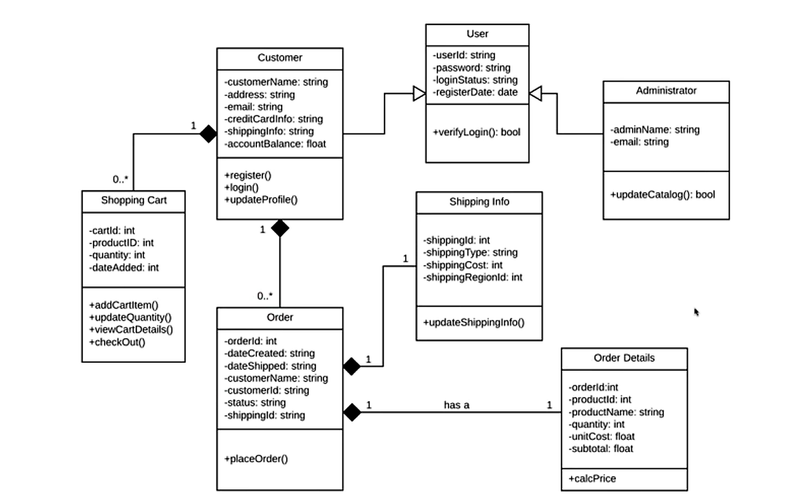

# UML Class Diagram – Relationships

UML (Unified Modeling Language) class diagrams represent the structure of a software application, including classes, attributes, methods, and relationships between classes.

There are four important relationships:

1. Association
2. Inheritance
3. Aggregation
4. Composition


## 1. Association

**Definition:** Association represents a relationship between two independent classes that interact with each other.

### Example: Doctor and Patient

- A Doctor examines a Patient.
- A Doctor can exist without a Patient.
- A Patient can exist without a Doctor.
- Neither class owns the lifecycle of the other.

### Java Example

```java
class Patient {
    String name;

    Patient(String name) {
        this.name = name;
    }
}

class Doctor {
    public void examinePatient(Patient patient) {
        System.out.println("Examining " + patient.name);
    }
}
```

### UML Representation

A solid line connects the two classes.

```text
+----------+             +----------+
|  Doctor  |-------------| Patient  |
+----------+             +----------+
```

**Remember:** Association means two independent classes interact with each other.

## 2. Inheritance (IS-A Relationship)

**Definition:** Inheritance allows one class to acquire the properties and methods of another class.

It represents an **IS-A relationship**.

### Example: Person, Doctor and Patient

- Doctor IS-A Person.
- Patient IS-A Person.
- Both inherit common properties from Person.

### Java Example

```java
class Person {
    String name;
    int age;
}

class Doctor extends Person {
    String specialization;
}

class Patient extends Person {
    String disease;
}
```

### UML Representation

A solid line with a hollow triangle pointing towards the parent class.

```text
          +----------+
          |  Person  |
          +----------+
               △
              / \
             /   \
+----------+       +----------+
|  Doctor  |       | Patient  |
+----------+       +----------+
```

**Remember:** Inheritance means one class IS-A type of another class.

Java keyword: `extends`

## 3. Aggregation (Weak HAS-A Relationship)

**Definition:** Aggregation represents a weak whole-part relationship where the parts can exist independently of the whole.

### Example: Hospital and Doctor

- A Hospital has Doctors.
- Doctors can exist independently of the Hospital.
- If a Hospital closes, its Doctors can work elsewhere.

### Java Example

```java
class Doctor {
    String name;

    Doctor(String name) {
        this.name = name;
    }
}

class Hospital {
    Doctor doctor;

    Hospital(Doctor doctor) {
        this.doctor = doctor;
    }
}
```

### Usage

```java
Doctor doctor = new Doctor("Rahul");

Hospital hospital = new Hospital(doctor);
```

The Doctor object is created independently and passed to the Hospital.

### UML Representation

A solid line with a hollow diamond near the whole (Hospital).

```text
+------------+ ◇---------- +----------+
|  Hospital  |             |  Doctor  |
+------------+             +----------+
```

**Remember:** Aggregation means a whole has parts, but those parts can exist independently.


## 4. Composition (Strong HAS-A Relationship)

**Definition:** Composition represents a strong whole-part relationship where the whole owns its parts and their lifecycles are tied together.

### Example: House and Room

Assume Rooms belong exclusively to a House in our application model.

- A House contains Rooms.
- The House owns its Rooms.
- If the House is destroyed, its Rooms are also considered destroyed in this model.

### Java Example

```java
class Room {
    String roomName;

    Room(String roomName) {
        this.roomName = roomName;
    }
}

class House {
    private Room room;

    House() {
        this.room = new Room("Bedroom");
    }
}
```

The House creates and owns the Room object.

### UML Representation

A solid line with a filled diamond near the whole (House).

```text
+---------+ ◆---------- +--------+
|  House  |             |  Room  |
+---------+             +--------+
```

**Remember:** Composition means a whole strongly owns its parts, and their lifecycles are tied together in the model.

## 5. Comparison of All Four Relationships

| Relationship | Meaning | Example |
|---|---|---|
| Association | Classes interact | Doctor examines Patient |
| Inheritance | IS-A | Doctor IS-A Person |
| Aggregation | Weak HAS-A | Hospital has Doctors |
| Composition | Strong HAS-A | House owns Rooms |

## 6. Aggregation vs Composition

An important interview question.

| Feature | Aggregation | Composition |
|---|---|---|
| Relationship | Weak HAS-A | Strong HAS-A |
| Ownership | Weak | Strong |
| Part exists independently? | Yes | Generally no |
| Lifecycle | Independent | Tied to whole |
| UML symbol | Hollow diamond (◇) | Filled diamond (◆) |

## 7. UML Symbols to Remember

| Symbol | Meaning |
|---|---|
| `+` | Public |
| `-` | Private |
| `#` | Protected |
| `~` | Package-private |
| `△` | Inheritance arrowhead |
| `◇` | Aggregation |
| `◆` | Composition |
| `────` | Association |

## Remember

- **Association** → Interaction.
- **Inheritance** → IS-A.
- **Aggregation** → Weak HAS-A.
- **Composition** → Strong HAS-A.


