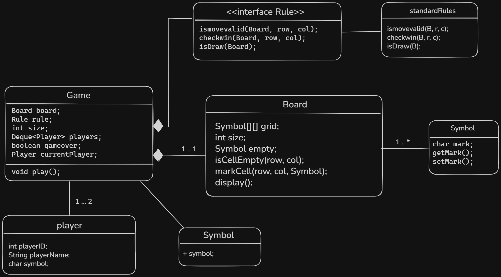

# Tic Tac Toe – Java LLD

My first Low Level Design (LLD) project: a simple two-player Tic Tac Toe game built using Java.

The main goal of this project was to understand how to break a problem into classes, assign responsibilities, and make those classes work together. Here, I tried to apply the SOLID design principles

## UML Class Diagram

## Features

- Two-player game (X and O).
- 3×3 game board.
- Validates player moves.
- Checks horizontal, vertical, and diagonal winning conditions.
- Detects draw conditions.
- Manages player turns using `Deque`.
- Allows the same player to retry after an invalid move.

## Technologies Used

- Java
- Object-Oriented Programming (OOP)
- 2D Array
- Deque
- Interfaces

## What I Learned

- How to design classes and assign responsibilities.
- How to apply encapsulation and abstraction.
- How interfaces separate rules from their implementation.
- How to manage player turns using `Deque`.
- How to represent a game board using a 2D array.
- How different classes communicate with each other.

## Problems I Solved

- Managing two players and their turns.
- Preventing players from selecting occupied cells.
- Handling invalid row and column positions.
- Checking all possible winning combinations.
- Detecting when the game ends in a draw.
- Ensuring an invalid move does not change the player's turn.

## What I Practised

Through this project, I gained practical experience with OOP concepts, class relationships, interfaces, abstraction, and basic Low Level Design.

**Status:** Completed