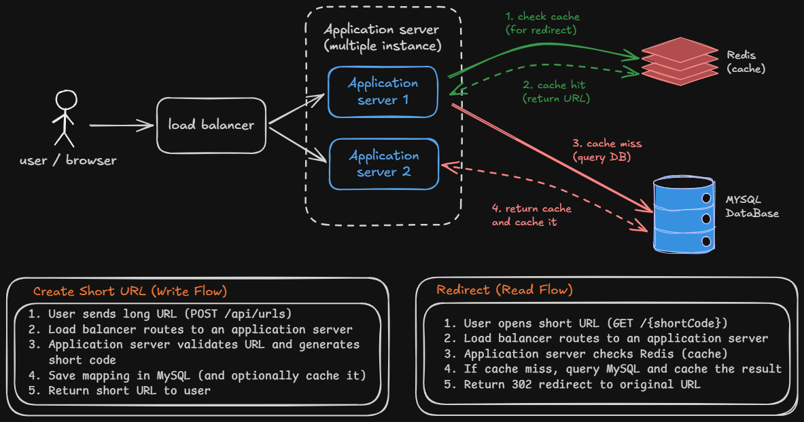
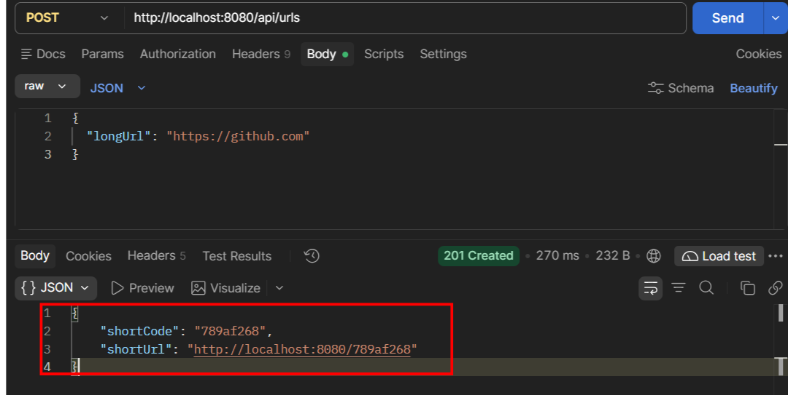
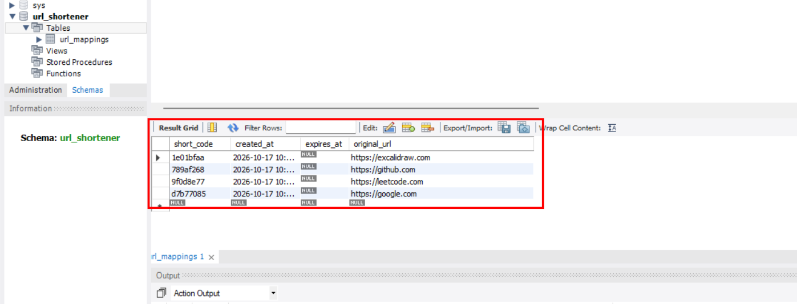
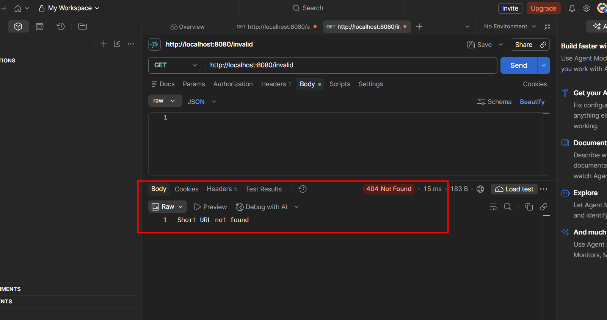
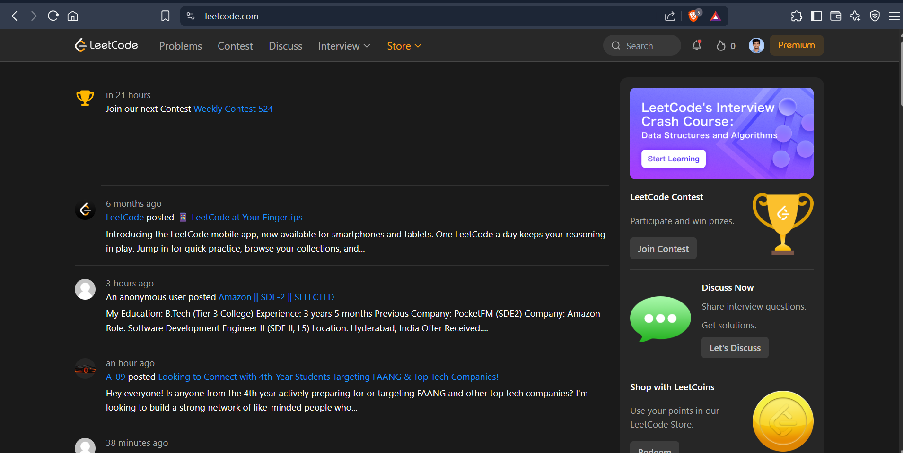

# URL Shortener

A simple URL Shortener built using Java, Spring Boot, and MySQL. It converts long URLs into short links and redirects users to the original URLs.

# Architecture



## Technologies Used

- Java 17
- Spring Boot
- Spring Data JPA
- MySQL
- Maven
- Postman

## Features

- Create short URLs.
- Store URL mappings in MySQL.
- Redirect short URLs to their original destinations.
- Return `404 Not Found` for invalid short codes.

## API Endpoints
Here i used two API end points 

| Method | Endpoint | Description |
|---|---|---|
| POST | `/api/urls` | Create a short URL |
| GET | `/{shortCode}` | Redirect to the original URL |

## Example Request

**POST** `/api/urls`

```json
{
  "longUrl": "https://www.google.com"
}
```

<h2>Screenshots</h2>

<h3>1. Create Short URL</h3>

This screenshot shows the successful creation of a short URL using the POST API in Postman.



<h3>2. Database Records</h3>

This screenshot shows the URL mappings stored in the MySQL database.



<h3>3. Invalid Short Code</h3>

This screenshot shows the `404 Not Found` response when an invalid short code is requested.



<h3>4. URL Redirection</h3>

This screenshot shows the redirect response and the original destination opened using the short URL.





## How to Run

1. Clone the repository.
2. Create a MySQL database named `url_shortener`.
3. Configure your database credentials in `application.properties` or set the `DB_PASSWORD` environment variable.
4. Run `UrlShortenerApplication.java`.
5. Test the APIs using Postman.

## Purpose
 
This project was built to learn Spring Boot, REST APIs, MySQL integration, and High-Level System Design (HLD).
